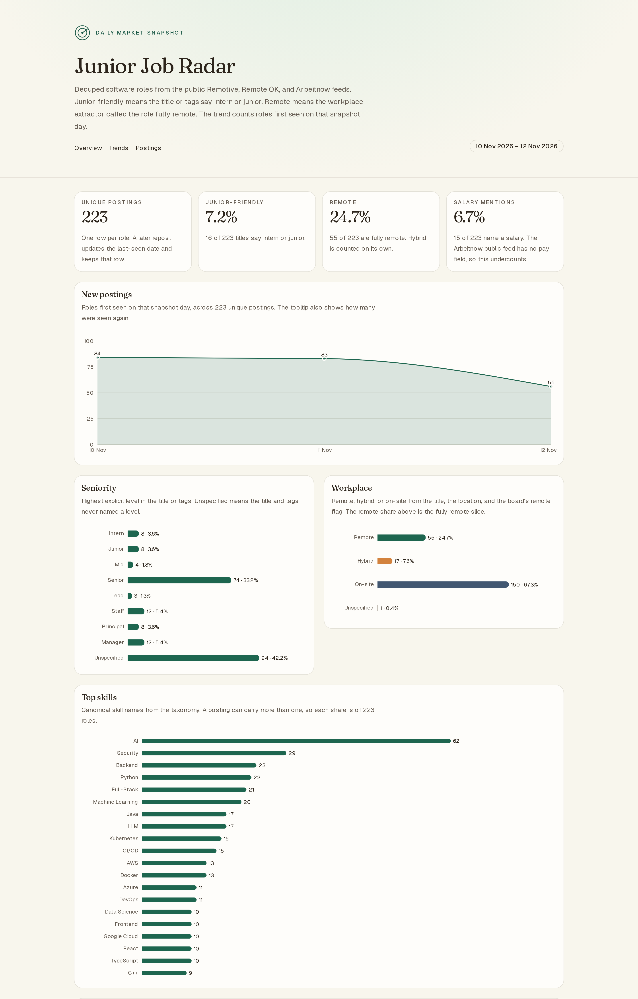
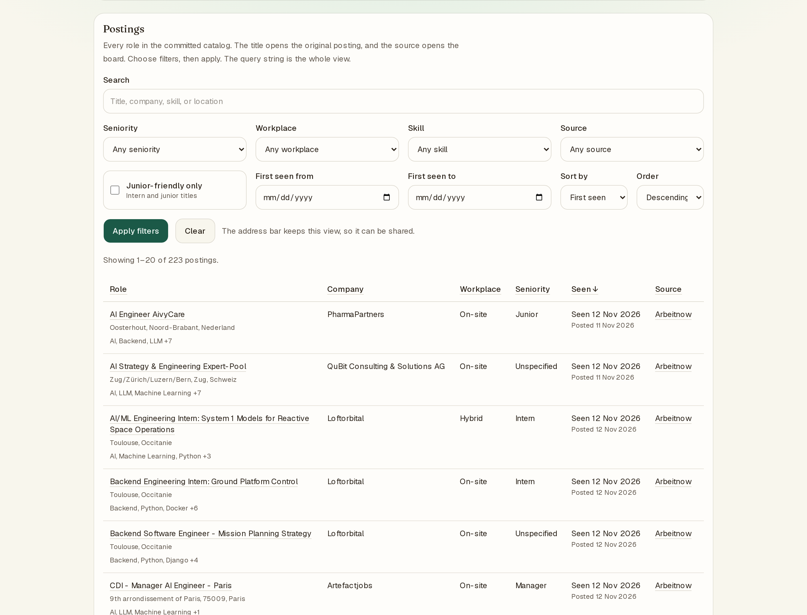
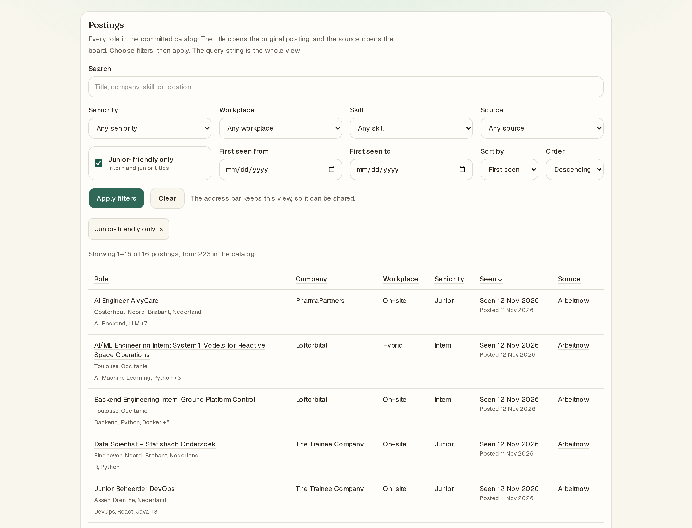
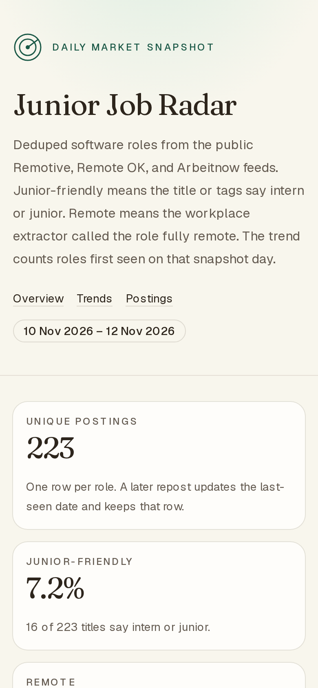

# Junior Job Radar

A daily record of public junior and remote software jobs, and a dashboard of what that record shows: which skills show up, how much of the market is remote, how thin the junior slice is, and how often a posting mentions pay.

Built by Abdullah, a software-engineering graduate in Karachi. The boards are free and need no API key. There is no paid service and no secret in the repo.

The day-by-day plan is in [docs/ROADMAP.md](docs/ROADMAP.md).

## Dashboard

The committed catalog, built as a static site. Figures below are the catalog in this repository (223 unique postings, 10–12 Nov 2026).









## Architecture

```text
pipeline/  →  data/  →  web/
```

1. **Pipeline.** `pipeline/` is a Python 3.12 package managed with [uv](https://docs.astral.sh/uv/). `jobradar fetch` calls Remotive, Remote OK, and Arbeitnow, normalizes software roles, and extracts seniority, skills, workplace, and regions.
2. **Data.** Each UTC date gets a raw snapshot and a normalized JSON and CSV file. The cross-day catalog is `data/jobradar.sqlite`, dumped to `data/catalog/postings.json`. Deduped counts for the charts are `data/catalog/trends.json`.
3. **Dashboard.** `web/` is a Next.js app. `npm run build` reads those two catalog files and writes a static site to `web/out`. The browser filters that snapshot. The page does not call the boards.

## Run it locally

Install [uv](https://docs.astral.sh/uv/getting-started/installation/) and Node.js 22. uv fetches Python 3.12 from the pin in `pipeline/.python-version` when you don't have it.

Pipeline:

```powershell
cd pipeline
uv sync
uv run jobradar fetch
uv run jobradar summary
uv run jobradar extract
uv run pytest
```

`fetch` writes three files for today's UTC date, then rebuilds the catalog from every snapshot:

- `data/raw/YYYY-MM-DD.json` — compact source payloads. Descriptions and logos are left out.
- `data/normalized/YYYY-MM-DD.json` and `.csv` — deduped software roles from that day.
- `data/jobradar.sqlite` and `data/catalog/postings.json` — one row per posting. The same canonical URL, or the same company and title, does not get a second row. `first_seen` stays on the earliest snapshot. A repost updates `last_seen`. `days.new` is the trend count.
- `data/catalog/trends.json` — top skills, seniority, workplace, junior-friendly count, and regions.

Running `fetch` again on the same UTC date refreshes that date's three snapshot files and leaves every other date on disk. A second fetch that sees the same postings does not rewrite the database. A role that disappears from the snapshot files drops out of the catalog. Deleting `data/jobradar.sqlite` and running `fetch` rebuilds it.

`summary` reads the latest normalized snapshot (or `--date YYYY-MM-DD`) and prints counts per source, the top 15 tags, the remote share, how many postings look junior, plus workplace, seniority, and top skills. That summary is one day's file, including roles that were already in an earlier snapshot.

`extract` fills seniority, skills, workplace, `junior_friendly`, and regions on snapshot rows stored before those fields existed, then rebuilds the catalog. Fetch already extracts new postings, so `extract` is the backfill.

Dashboard:

```powershell
cd web
npm install
npm run dev
```

Open `http://localhost:3000/junior-job-radar/`. The overview is the top of the page. Filters and the postings table are below the charts. The query string keeps seniority, workplace, skill, source, first-seen dates, text search, junior-friendly only, sort, and page, so a filtered view can be shared. Unknown values are dropped and the address bar is replaced with the canonical query. Each title links to the original posting, and each source links to the board.

`npm run build` writes `web/out`. `npm run start` serves that folder at `http://127.0.0.1:3000/junior-job-radar/`.

## Tests and CI

Pipeline, from `pipeline/`:

```powershell
uv run pytest
```

Dashboard, from `web/`:

```powershell
npm test
npm run lint
npm run typecheck
npm run build
npx playwright install chromium
npm run e2e
```

`npm test` covers the filter parser and the per-board status notice. Playwright drives Chromium against the static export and the committed catalog. It checks the overview figures, the four charts, each filter, pagination, sort, both empty states, the mobile card list, and that scripts load from `/junior-job-radar/_next/`. A request to Remotive, Remote OK, or Arbeitnow fails the test. If `CI` is unset, Playwright builds before it starts the server.

[`.github/workflows/ci.yml`](.github/workflows/ci.yml) runs on pull requests and on pushes to `main`. It runs `uv run pytest`, then in `web/` runs `npm ci`, lint, typecheck, `npm test`, `npm run build`, and Playwright. Actions are pinned to full commit SHAs. The token is `contents: read`. A newer run on the same ref cancels the older one. The Playwright HTML report is uploaded only when the dashboard job fails.

## Daily data

[`.github/workflows/daily-fetch.yml`](.github/workflows/daily-fetch.yml) runs at 06:15 UTC, and when someone starts it by hand from `main`. It runs `uv run pytest`, then `uv run jobradar fetch`.

The job commits changes under `data/` onto `automation/daily-snapshots` and opens a pull request into `main`. It does not push `main` and it does not deploy the site. The only credential is the run's `GITHUB_TOKEN`, limited to `contents: write` and `pull-requests: write` on that job. The boards need no API key. Actions are pinned to full commit SHAs. A run with no data change does not create an empty commit. Two runs cannot overlap.

The schedule starts after this workflow is on `main`. Until the data pull request is merged, the next day checks out `automation/daily-snapshots` (so unmerged days stack) and merges `main` into it. Merging the data pull request is a push to `main`, which runs the Pages workflow and publishes the new catalog.

The 12, 13, and 14 November 2026 runs fetched and pushed `automation/daily-snapshots`, then failed at `gh pr create` with `GitHub Actions is not permitted to create or approve pull requests`. `pull-requests: write` was already granted. Opening the pull request also needs a repository setting that is off by default on a personal account: **Settings → Actions → General → Workflow permissions → Allow GitHub Actions to create and approve pull requests**. The workflow does not use a personal access token to skip that checkbox. After it is saved, the next run opens the pull request for the commits already on the data branch.

## Deploy and rollback

GitHub Pages hosts the static export. [`.github/workflows/pages.yml`](.github/workflows/pages.yml) runs on a push to `main` and on `workflow_dispatch`. Both jobs run only when the ref is `main`. The build job runs `npm ci` and `npm run build`, then uploads `web/out`. The deploy job publishes that artifact. Actions are pinned to full commit SHAs. The workflow permission is `contents: read`. The deploy job replaces it with `pages: write` and `id-token: write` only. There is no secret.

`basePath` and `assetPrefix` are `/junior-job-radar`, so the site is [https://abdullah4589.github.io/junior-job-radar/](https://abdullah4589.github.io/junior-job-radar/). The artifact root is the site root. Asset URLs are `/junior-job-radar/_next/...`, not a doubled prefix.

The workflow can publish only after the repository source is GitHub Actions:

**Settings → Pages → Build and deployment → Source: GitHub Actions**

That control is not in this repo. Until it is saved, the deploy job cannot create the site. A failed deploy does not take down a site that is already up.

Rollback, after the site is live:

1. **Re-publish a known good commit.** Actions → Pages → open the last good run on `main` → **Re-run all jobs**. The re-run checks out that commit, builds `web/out`, and deploys it.
2. **Revert the merge.** Revert the merge commit on `main` (a revert pull request is enough). The push to `main` builds the reverted tree and deploys it.
3. **Take the site offline.** **Settings → Pages → Unpublish site.**

## What gets stored

Every normalized posting has the same fields:

`id`, `source`, `title`, `company`, `location`, `remote`, `tags`, `salary_text`, `posted_at`, `url`, `fetched_at`, `seniority`, `skills`, `workplace`, `junior_friendly`, `regions`

A posting is kept when the title (or a Remotive software category, or an Arbeitnow "Software Development" tag) looks like a software role. Sales, nursing, accounting, and similar listings from the same feeds stay in the raw snapshot and stay out of the normalized file.

Duplicates inside one run are collapsed. The same URL matches after tracking parameters are stripped. The same company and title match after punctuation and suffixes like "Inc" or "GmbH" are folded. The record with a salary, more tags, or a posted date wins.

Junior / entry-level is `junior_friendly`: seniority `intern` or `junior`, taken from the title and tags. The highest explicit level wins, so a senior title stays senior when the description mentions mentoring juniors. `workplace` is `remote`, `hybrid`, `onsite`, or `unknown` and does not replace the `remote` boolean. `skills` are canonical names from `pipeline/src/jobradar/taxonomy/skills.json` (`js` and `k8s` fold to JavaScript and Kubernetes). `regions` are limits stated by the title, the location, or a phrase like "must be located in".

Tags are lowercased. Skills named in the title are added so the three boards can be compared. Remote OK's API attaches unrelated tags (a nurse role can be tagged `golang`), so a Remote OK tag is kept only when the title also says it. Generic labels (`engineer`, `full time`) and parenthetical team names are dropped.

## Sources

One request per source per run. If a source times out or returns a bad payload, the run logs the error and continues. Requests use a 20s timeout, up to 3 attempts, and a `JuniorJobRadar` User-Agent.

| Source | Endpoint | Notes |
| --- | --- | --- |
| [Remotive](https://remotive.com) | `https://remotive.com/api/remote-jobs` | Public, delayed about 24 hours. Link the Remotive job URL and mention Remotive. Their docs ask for at most a few calls a day. The free feed currently ignores `category` and `search` and returns a small list. |
| [Remote OK](https://remoteok.com) | `https://remoteok.com/api` | Public JSON. Link each job URL with a normal follow link and mention Remote OK. Their logo is not used. |
| [Arbeitnow](https://www.arbeitnow.com) | `https://www.arbeitnow.com/api/job-board-api` | Free job-board API. Page 1 is the newest 300 posts. Please link back to Arbeitnow. This board is not remote-only, so `remote` comes from the payload. |

Checked and not used: The Muse's old public jobs URL (`https://www.themuse.com/api/public/jobs`) responds with 404.

Salary text is whatever the board provided. Remote OK's `0` minimum and maximum mean "not stated" and become an empty salary. Arbeitnow's public records do not include a salary field, so the salary-mention rate undercounts.

## Limitations

These three boards are a biased sample, not the job market.

- They are senior-heavy. On the committed catalog, 16 of 223 titles say intern or junior (7.2%). A title that only says "Software Engineer" is not counted as junior.
- They are not a clean remote sample either. Remotive and Remote OK are remote boards. Arbeitnow's first page is mostly on-site roles in Europe, and it dominates the count, so the remote share (55 of 223, 24.7%) is lower than a remote-only reading and higher than a general jobs board.
- Remotive's free API currently returns a short list, ignores `category` and `search`, and is delayed about 24 hours.
- Remote OK's tag list is noisy. Normalized tags keep a Remote OK tag only when the title supports it. A description or tag list that names more than 12 skills is ignored as a catalog of other roles. The title still counts.
- Salary coverage is incomplete. The rate counts rows with `salary_text`. Arbeitnow has no pay field. Remote OK's zeros are not salaries. The dashboard does not invent pay.
- The extractor does not understand negation ("Java is not required" still counts Java). `Go`, `R`, and `C` are matched cautiously so ordinary words are not skills. Seniority is read from the title and tags, not the description. Snapshots from before Day 3 have no description text, so their skills come from the title and tags.
- The dashboard is the catalog at build time. It changes when a data pull request is merged and the Pages workflow finishes, not when a board edits a posting.

## Layout

```text
pipeline/                         Python 3.12 package (uv)
data/raw/                         One compact payload file per UTC date
data/normalized/                  One JSON and one CSV per UTC date
data/catalog/postings.json        Deduped catalog, one row per posting
data/catalog/trends.json          Top skills, seniority, workplace, regions
data/jobradar.sqlite              Same catalog in SQLite
pipeline/src/jobradar/taxonomy/   Skill, seniority, and region lists
.github/workflows/daily-fetch.yml Daily fetch. Opens a pull request, does not push main
.github/workflows/ci.yml          Pipeline pytest, dashboard checks, and Playwright
.github/workflows/pages.yml       Static export, deployed to GitHub Pages
docs/screenshots/                 Playwright captures of the built dashboard
web/                              Next.js dashboard. Static export under /junior-job-radar/
```

## License

MIT. Job text remains the property of the boards and the employers. This project stores titles, companies, tags, and links so the dashboard can cite them.
